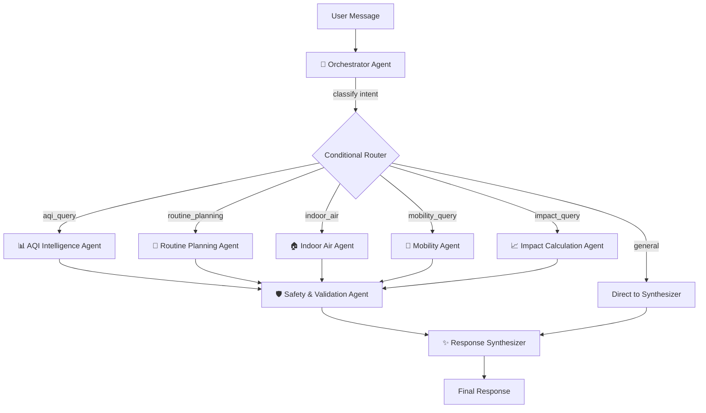
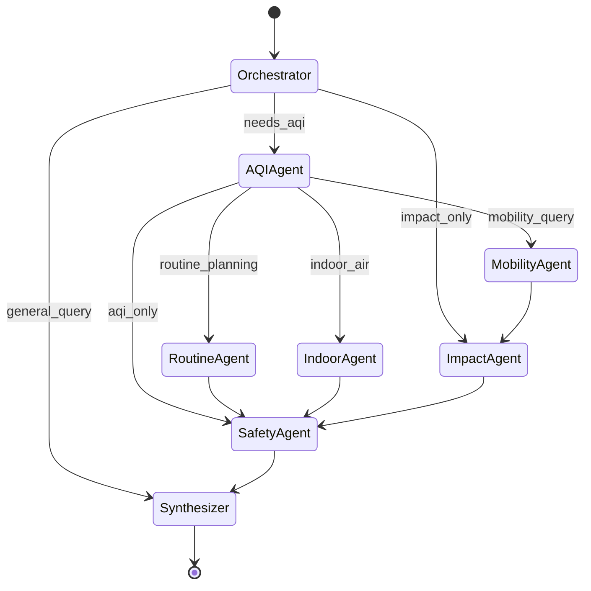
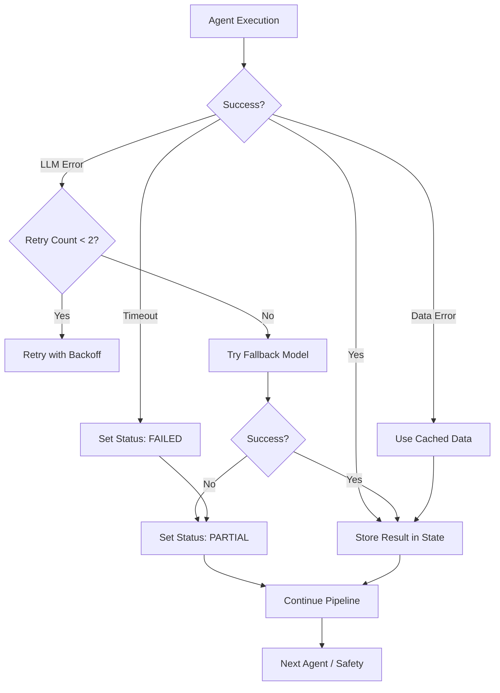

# AirAware AI — Multi-Agent AI Architecture

## 1. Overview

AirAware AI uses a **LangGraph-based multi-agent architecture** where specialized AI agents collaborate to answer user queries about air quality, health guidance, commute planning, and sustainability. An Orchestrator agent classifies user intent and dynamically routes to the appropriate subset of agents, which execute in parallel where possible. A Safety agent validates all outputs before the Response Synthesizer produces the final user-facing answer.



---

## 2. LangGraph State Schema

The shared state object flows through the entire agent graph. It is defined as a typed Pydantic model ensuring validation at every step.

```python
from __future__ import annotations
from pydantic import BaseModel, Field
from typing import Optional
from datetime import datetime
from enum import Enum
from uuid import UUID


class IntentType(str, Enum):
    AQI_QUERY = "aqi_query"
    ROUTINE_PLANNING = "routine_planning"
    INDOOR_AIR = "indoor_air"
    MOBILITY_QUERY = "mobility_query"
    IMPACT_QUERY = "impact_query"
    GENERAL = "general"
    MULTI_INTENT = "multi_intent"


class ExecutionStatus(str, Enum):
    PENDING = "pending"
    RUNNING = "running"
    COMPLETED = "completed"
    FAILED = "failed"
    PARTIAL = "partial"


class LocationContext(BaseModel):
    """Resolved location for the query."""
    location_id: Optional[UUID] = None
    name: str
    latitude: float
    longitude: float
    city: Optional[str] = None
    state: Optional[str] = None


class UserProfileContext(BaseModel):
    """User profile information relevant to agent decisions."""
    age_group: Optional[str] = None                    # child, adult, elderly
    health_sensitivities: list[str] = Field(default_factory=list)  # asthma, copd, etc.
    activity_level: Optional[str] = None               # sedentary, moderate, active
    household_members: int = 1
    preferred_transport: Optional[str] = None
    sensitivity_level: str = "normal"                   # low, normal, high


class EnvironmentalContext(BaseModel):
    """Current environmental data retrieved by agents."""
    current_aqi: Optional[int] = None
    aqi_category: Optional[str] = None                 # Good, Satisfactory, Moderate, Poor, Very Poor, Severe
    dominant_pollutant: Optional[str] = None
    pm25: Optional[float] = None
    pm10: Optional[float] = None
    no2: Optional[float] = None
    so2: Optional[float] = None
    co: Optional[float] = None
    o3: Optional[float] = None
    temperature: Optional[float] = None
    humidity: Optional[float] = None
    wind_speed: Optional[float] = None
    data_timestamp: Optional[datetime] = None
    forecast_hours: list[dict] = Field(default_factory=list)


class AgentResult(BaseModel):
    """Result from a single agent execution."""
    agent_name: str
    status: ExecutionStatus = ExecutionStatus.PENDING
    result_data: Optional[dict] = None
    recommendations: list[str] = Field(default_factory=list)
    confidence: float = 0.0                            # 0.0 to 1.0
    error_message: Optional[str] = None
    execution_time_ms: Optional[int] = None
    tokens_used: int = 0


class SourceReference(BaseModel):
    """Data source attribution."""
    source_name: str                                   # OpenAQ, Open-Meteo, CPCB, etc.
    data_type: str                                     # measurement, forecast, guideline
    retrieved_at: datetime
    data_age_minutes: Optional[int] = None
    url: Optional[str] = None
    is_stale: bool = False


class ValidationResult(BaseModel):
    """Results from safety and validation checks."""
    is_valid: bool = True
    warnings: list[str] = Field(default_factory=list)
    data_quality_score: float = 1.0                    # 0.0 to 1.0
    stale_sources: list[str] = Field(default_factory=list)
    claim_checks: list[dict] = Field(default_factory=list)
    recommendation_overrides: list[dict] = Field(default_factory=list)


class AirAwareState(BaseModel):
    """
    Complete state schema for the AirAware LangGraph agent pipeline.
    This state flows through all agents, accumulating data and results.
    """
    # Request identification
    request_id: UUID
    user_id: UUID
    conversation_id: UUID

    # User input
    user_message: str

    # Orchestrator outputs
    classified_intent: Optional[IntentType] = None
    selected_agents: list[str] = Field(default_factory=list)

    # Location context
    selected_location: Optional[LocationContext] = None

    # User context
    user_profile_context: Optional[UserProfileContext] = None

    # Environmental data (populated by AQI agent)
    environmental_context: Optional[EnvironmentalContext] = None

    # Agent execution results (keyed by agent name)
    agent_execution_results: dict[str, AgentResult] = Field(default_factory=dict)

    # Source tracking
    source_references: list[SourceReference] = Field(default_factory=list)

    # Validation results (populated by Safety agent)
    validation_results: Optional[ValidationResult] = None

    # Final output
    final_response: Optional[str] = None

    # Execution metadata
    execution_status: ExecutionStatus = ExecutionStatus.PENDING
    error_details: Optional[str] = None
    total_tokens_used: int = 0
    total_execution_time_ms: int = 0
    created_at: datetime = Field(default_factory=datetime.utcnow)
```

---

## 3. Agent Specifications

### 3.1 Orchestrator Agent

**Purpose:** Classify user intent, extract location, resolve user profile, and determine which agents to invoke.

| Property | Value |
|----------|-------|
| LLM | GPT-4o-mini (fast classification) |
| Token Budget | ~500 tokens |
| Timeout | 5 seconds |
| Fallback | Default to `GENERAL` intent, route to Synthesizer only |

**Responsibilities:**
1. **Intent Classification** — Parse the user message and classify into one of `IntentType` values. For multi-faceted queries (e.g., "Should I bike to work and is it safe to open windows?"), classify as `MULTI_INTENT` and select multiple agents.
2. **Location Extraction** — Identify location references in the message. Resolve against user's saved locations or geocode new ones. If ambiguous, use user's default/primary location.
3. **User Profile Loading** — Fetch user profile context (health sensitivities, age group, preferences) from the database.
4. **Agent Selection** — Based on classified intent, populate `selected_agents` list.

**Intent-to-Agent Mapping:**

| Intent | Agents Invoked |
|--------|---------------|
| `aqi_query` | AQI Intelligence |
| `routine_planning` | AQI Intelligence → Routine Planning |
| `indoor_air` | AQI Intelligence → Indoor Air |
| `mobility_query` | AQI Intelligence → Mobility → Impact Calculation |
| `impact_query` | Impact Calculation |
| `general` | (none — direct to Synthesizer) |
| `multi_intent` | (combination based on sub-intents) |

### 3.2 AQI Intelligence Agent

**Purpose:** Retrieve, interpret, and contextualize air quality data for the user's location.

| Property | Value |
|----------|-------|
| LLM | GPT-4o-mini (data interpretation) |
| Token Budget | ~800 tokens |
| Timeout | 10 seconds |
| Data Sources | OpenAQ, Open-Meteo, Redis cache |

**Responsibilities:**
1. **Data Retrieval** — Fetch current AQI measurements from cache or external APIs for the selected location. Find nearest monitoring stations within 25 km radius.
2. **CPCB AQI Calculation** — Compute Indian AQI from individual pollutant sub-indices using CPCB breakpoint concentrations:

| Category | AQI Range | PM2.5 (µg/m³) | PM10 (µg/m³) |
|----------|-----------|----------------|---------------|
| Good | 0–50 | 0–30 | 0–50 |
| Satisfactory | 51–100 | 31–60 | 51–100 |
| Moderate | 101–200 | 61–90 | 101–250 |
| Poor | 201–300 | 91–120 | 251–350 |
| Very Poor | 301–400 | 121–250 | 351–430 |
| Severe | 401–500 | 250+ | 430+ |

3. **Forecast Assembly** — Retrieve 24–120 hour forecast data from Open-Meteo Air Quality API.
4. **Contextualization** — Generate human-readable interpretation: what the AQI means, health implications for user's sensitivity level, comparison to typical values.
5. **Source Attribution** — Record all data sources with timestamps in `source_references`.

### 3.3 Routine Planning Agent

**Purpose:** Generate pollution-aware daily schedules optimized for the user's activities and health profile.

| Property | Value |
|----------|-------|
| LLM | GPT-4o (complex reasoning) |
| Token Budget | ~1200 tokens |
| Timeout | 15 seconds |
| Dependencies | AQI Intelligence Agent (environmental_context) |

**Responsibilities:**
1. **Activity Window Identification** — Using forecast data, identify time windows where AQI is lowest (best for outdoor activities) and highest (stay indoors).
2. **Schedule Generation** — Create a prioritized daily schedule considering:
   - User's typical activities and routine preferences
   - Optimal exercise windows (early morning, post-sunset typically)
   - Commute timing relative to pollution peaks (rush hour correlation)
   - Indoor/outdoor activity distribution based on current AQI category
3. **Health-Aware Adjustments** — Modify recommendations based on user sensitivity:
   - `high` sensitivity: Stricter thresholds, more indoor alternatives, mask recommendations
   - `normal`: Standard CPCB-based thresholds
   - `low`: Relaxed thresholds with general awareness
4. **Routine Item Generation** — Output structured routine items with time, activity, location type (indoor/outdoor), and rationale.

### 3.4 Indoor Air Agent

**Purpose:** Provide ventilation scheduling, filtration guidance, and household air quality management.

| Property | Value |
|----------|-------|
| LLM | GPT-4o-mini |
| Token Budget | ~800 tokens |
| Timeout | 10 seconds |
| Dependencies | AQI Intelligence Agent (environmental_context) |

**Responsibilities:**
1. **Ventilation Scheduling** — Based on outdoor AQI forecast, recommend specific windows for opening/closing windows. Rule engine:
   - AQI < 100 (Good/Satisfactory): "Open windows for ventilation"
   - AQI 101–200 (Moderate): "Limited ventilation during lowest AQI windows only"
   - AQI > 200 (Poor+): "Keep all windows closed, use air purifiers"
2. **Filtration Guidance** — Recommend air purifier CADR ratings based on room size and outdoor AQI. Provide filter replacement reminders.
3. **Indoor Pollutant Sources** — Identify common household pollution sources (cooking with gas, incense, cleaning chemicals, new furniture VOCs) and mitigation steps.
4. **Plant Recommendations** — Suggest air-purifying indoor plants with care instructions (Areca Palm, Snake Plant, Money Plant, Peace Lily).
5. **Seasonal Guidance** — Adjust recommendations for Delhi winter smog, monsoon mold, summer dust storms.

### 3.5 Mobility Agent

**Purpose:** Compare transport modes for air quality exposure and provide route-aware commute recommendations.

| Property | Value |
|----------|-------|
| LLM | GPT-4o-mini |
| Token Budget | ~800 tokens |
| Timeout | 10 seconds |
| Dependencies | AQI Intelligence Agent (environmental_context) |

**Responsibilities:**
1. **Mode Comparison** — Compare up to 6 transport modes (walk, cycle, auto-rickshaw, bus, metro, car) across:
   - Travel time estimate
   - Pollution exposure score (ventilation factor × AQI × duration)
   - Emission impact (from Impact Calculation Agent)
   - Cost estimate (approximate)
2. **Exposure Calculation** — Apply ventilation factors per mode:
   - Walking/Cycling: 1.0× (full outdoor exposure) × elevated breathing rate multiplier
   - Auto-rickshaw: 0.9× (open vehicle)
   - Bus (non-AC): 0.7×
   - Bus (AC): 0.4×
   - Metro: 0.2× (underground, filtered)
   - Car (AC, windows up): 0.3×
3. **Route Awareness** — Factor in traffic corridors and industrial zones if location data is available.
4. **Recommendation** — Rank transport modes by health-adjusted score considering user preferences.

### 3.6 Impact Calculation Agent

**Purpose:** Perform deterministic emission calculations and track user sustainability impact.

| Property | Value |
|----------|-------|
| LLM | None (deterministic calculations) |
| Token Budget | 0 |
| Timeout | 2 seconds |
| Dependencies | None (can run independently) |

**Responsibilities:**
1. **Emission Calculation** — Compute CO₂, NOx, PM2.5, PM10 emissions per km per transport mode using Indian emission factors:

| Mode | CO₂ (g/km) | NOx (mg/km) | PM2.5 (mg/km) |
|------|-----------|-------------|----------------|
| Walking | 0 | 0 | 0 |
| Cycling | 0 | 0 | 0 |
| Auto-Rickshaw (CNG) | 65 | 40 | 2 |
| Bus (per passenger) | 20 | 150 | 8 |
| Metro (per passenger) | 15 | 0 | 0 |
| Car (Petrol, BS-VI) | 120 | 25 | 1.5 |
| Car (Diesel, BS-VI) | 110 | 60 | 4 |
| Electric Car | 0* | 0 | 0 |
| Motorcycle (BS-VI) | 40 | 30 | 3 |

*\*Zero tailpipe. Grid emission factor applied separately: ~700 g CO₂/kWh for Indian grid.*

2. **Comparative Analysis** — Calculate savings vs. worst-case mode (single-occupancy car).
3. **Equivalent Impact** — Convert emissions to relatable units (trees needed to offset, kWh equivalent, litres of fuel).
4. **Milestone Tracking** — Check if user has hit sustainability milestones (first 100 kg CO₂ saved, 30-day streak, etc.).

### 3.7 Safety & Validation Agent

**Purpose:** Validate data quality, check claim accuracy, and ensure recommendations are safe.

| Property | Value |
|----------|-------|
| LLM | GPT-4o-mini (claim verification) |
| Token Budget | ~500 tokens |
| Timeout | 5 seconds |
| Dependencies | All preceding agent results |

**Responsibilities:**
1. **Data Freshness Validation** — Check all data sources in `source_references`. Flag any source older than 2 hours as stale. Downgrade confidence for stale data.
2. **Claim Verification** — Validate that agent recommendations are consistent with the data:
   - If AQI is Severe (400+), no agent should recommend outdoor exercise
   - If AQI is Good (< 50), indoor-only recommendations should be questioned
   - Emission calculations should be within plausible ranges
3. **Safety Guardrails** — Ensure no recommendation could endanger health:
   - Always recommend masks for prolonged outdoor activity when AQI > 200
   - Never recommend vigorous outdoor exercise when AQI > 300
   - Always suggest medical consultation for users with respiratory conditions when AQI > 200
4. **Data Quality Scoring** — Compute overall data quality score (0.0–1.0) based on source freshness, station proximity, and data completeness.
5. **Override Insertion** — Inject safety warnings or modify recommendations that fail validation.

### 3.8 Response Synthesizer

**Purpose:** Combine all agent outputs into a coherent, user-friendly response.

| Property | Value |
|----------|-------|
| LLM | GPT-4o (high-quality synthesis) |
| Token Budget | ~1500 tokens |
| Timeout | 15 seconds |
| Dependencies | All agent results + validation results |

**Responsibilities:**
1. **Result Aggregation** — Collect all `agent_execution_results` and merge into a coherent narrative.
2. **Response Formatting** — Structure the response with:
   - Direct answer to the user's question (first sentence)
   - Supporting data with specific numbers and categories
   - Actionable recommendations (numbered list)
   - Source attribution footer
   - Confidence/data quality disclaimer if score < 0.8
3. **Tone Calibration** — Adjust urgency and language based on AQI severity:
   - Good/Satisfactory: Encouraging, positive tone
   - Moderate/Poor: Informative, cautionary tone
   - Very Poor/Severe: Urgent, directive tone with safety emphasis
4. **Validation Warning Injection** — Include any warnings or overrides from the Safety agent.
5. **Token Management** — Stay within response length limits while preserving all critical information.

---

## 4. Graph Topology & Execution Flow

### 4.1 LangGraph Graph Definition



### 4.2 Conditional Edge Logic

```python
def route_after_orchestrator(state: AirAwareState) -> str:
    """Determine next node after orchestrator classification."""
    intent = state.classified_intent

    if intent == IntentType.GENERAL:
        return "synthesizer"

    if intent == IntentType.IMPACT_QUERY:
        return "impact_agent"

    # All other intents need AQI data first
    return "aqi_agent"


def route_after_aqi(state: AirAwareState) -> list[str]:
    """Determine which agents to invoke after AQI data is available."""
    intent = state.classified_intent
    agents = state.selected_agents
    next_nodes = []

    if "routine_agent" in agents:
        next_nodes.append("routine_agent")
    if "indoor_agent" in agents:
        next_nodes.append("indoor_agent")
    if "mobility_agent" in agents:
        next_nodes.append("mobility_agent")

    if not next_nodes:
        return ["safety_agent"]

    return next_nodes


def route_after_mobility(state: AirAwareState) -> str:
    """Mobility always chains to Impact for emission data."""
    return "impact_agent"


def all_agents_to_safety(state: AirAwareState) -> str:
    """All domain agents converge to Safety validation."""
    return "safety_agent"
```

### 4.3 Parallel Execution Strategy

LangGraph supports parallel node execution when multiple nodes are returned from a conditional edge. AirAware leverages this in two key patterns:

**Pattern 1: Post-AQI Fan-Out**

When a `MULTI_INTENT` query requires multiple domain agents (e.g., routine + indoor), they execute in parallel after the AQI agent provides environmental context:

```
AQI Agent (sequential — provides shared data)
    ├── Routine Agent  ─┐
    ├── Indoor Agent   ─┤── (parallel execution)
    └── Mobility Agent ─┘
                         → Safety Agent (waits for all)
```

**Pattern 2: Independent Impact**

For pure impact queries, the Impact Calculation Agent runs independently without AQI data (it uses deterministic emission factors, not live pollution data):

```
Orchestrator → Impact Agent → Safety Agent → Synthesizer
```

### 4.4 Error Handling Strategy



**Error Recovery Rules:**

| Error Type | Recovery Strategy | User Impact |
|-----------|------------------|-------------|
| LLM timeout | Retry once with fallback model | Slight delay |
| LLM rate limit | Queue with exponential backoff | Response delay warning |
| External API down | Use cached/stale data | Data freshness warning badge |
| Agent crash | Skip agent, mark PARTIAL | Partial response with note |
| All agents fail | Return error with cached summary | Error message + last known data |
| Validation failure | Override unsafe recommendations | Automatic safety insertion |

---

## 5. Token Budget Management

### 5.1 Per-Request Token Allocation

| Component | Input Tokens | Output Tokens | Model |
|-----------|-------------|---------------|-------|
| Orchestrator | ~300 | ~200 | GPT-4o-mini |
| AQI Agent | ~500 | ~300 | GPT-4o-mini |
| Domain Agent (each) | ~600 | ~400 | GPT-4o / mini |
| Safety Agent | ~400 | ~200 | GPT-4o-mini |
| Synthesizer | ~800 | ~700 | GPT-4o |
| **Total (typical)** | **~2,600** | **~1,800** | — |

### 5.2 Cost Optimization

- **Intent-based routing** ensures only necessary agents run (simple AQI query uses 2 agents, not 5)
- **GPT-4o-mini** for classification and simple tasks (10× cheaper than GPT-4o)
- **Deterministic agents** (Impact Calculator) use zero LLM tokens
- **Response caching** for identical queries within 5-minute window
- **Early termination** if token budget is exceeded mid-pipeline

---

## 6. Prompt Engineering Patterns

### 6.1 System Prompt Structure

Each agent receives a structured system prompt with:

```
[ROLE]: You are the {Agent Name} in the AirAware AI system.
[CONTEXT]: Current environmental data and user profile.
[TASK]: Specific task description with output format.
[CONSTRAINTS]: Token limits, safety rules, data requirements.
[OUTPUT FORMAT]: JSON schema for structured output.
```

### 6.2 Output Format Enforcement

All agents return structured JSON outputs parsed by Pydantic models. The LLM is instructed to output valid JSON matching the `AgentResult` schema. If JSON parsing fails, the agent falls back to text extraction with regex patterns.

### 6.3 Context Window Management

- Conversation history is truncated to the most recent 10 messages
- System prompts are pre-compiled and cached
- Environmental data is summarized before injection (raw data → key metrics)
- Agent results are compressed before passing to downstream agents

---

## 7. Observability

### 7.1 Agent Run Tracking

Every agent execution is recorded in the `agent_runs` and `agent_run_steps` database tables:

| Field | Description |
|-------|-------------|
| `agent_name` | Which agent ran |
| `status` | pending / running / completed / failed |
| `input_tokens` | Tokens in the prompt |
| `output_tokens` | Tokens in the response |
| `execution_time_ms` | Wall-clock time |
| `model_used` | Actual LLM model used |
| `error_message` | Error details if failed |

### 7.2 Tracing

Each request gets a `request_id` (UUID) that propagates through all agent calls, LLM requests, and database operations. This enables end-to-end request tracing for debugging and performance analysis.

### 7.3 Performance Benchmarks

| Metric | Target | Alert Threshold |
|--------|--------|----------------|
| End-to-end latency (simple query) | < 3s | > 5s |
| End-to-end latency (multi-agent) | < 8s | > 12s |
| Orchestrator classification time | < 1s | > 2s |
| Individual agent time | < 3s | > 5s |
| Safety validation time | < 1s | > 2s |

---

*Last updated: Phase 0 — Foundation*
