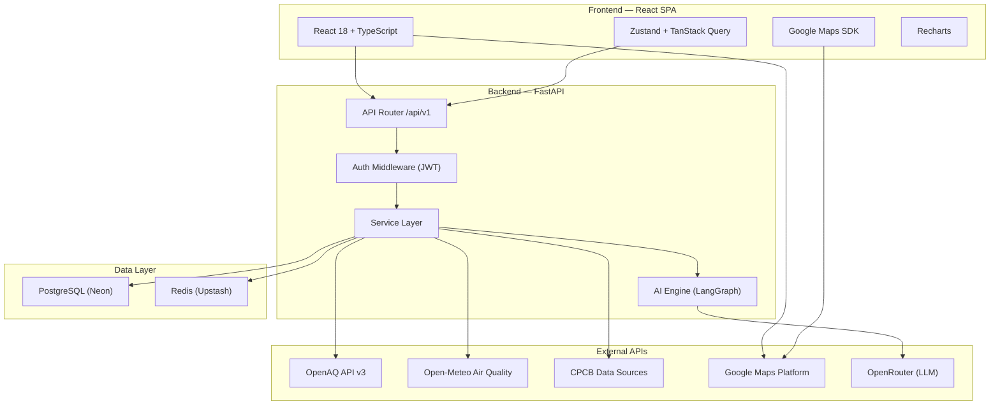
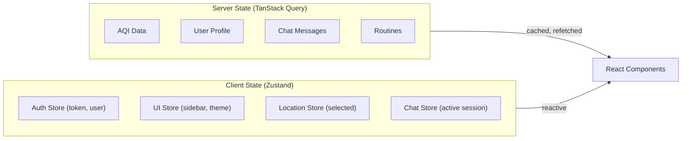
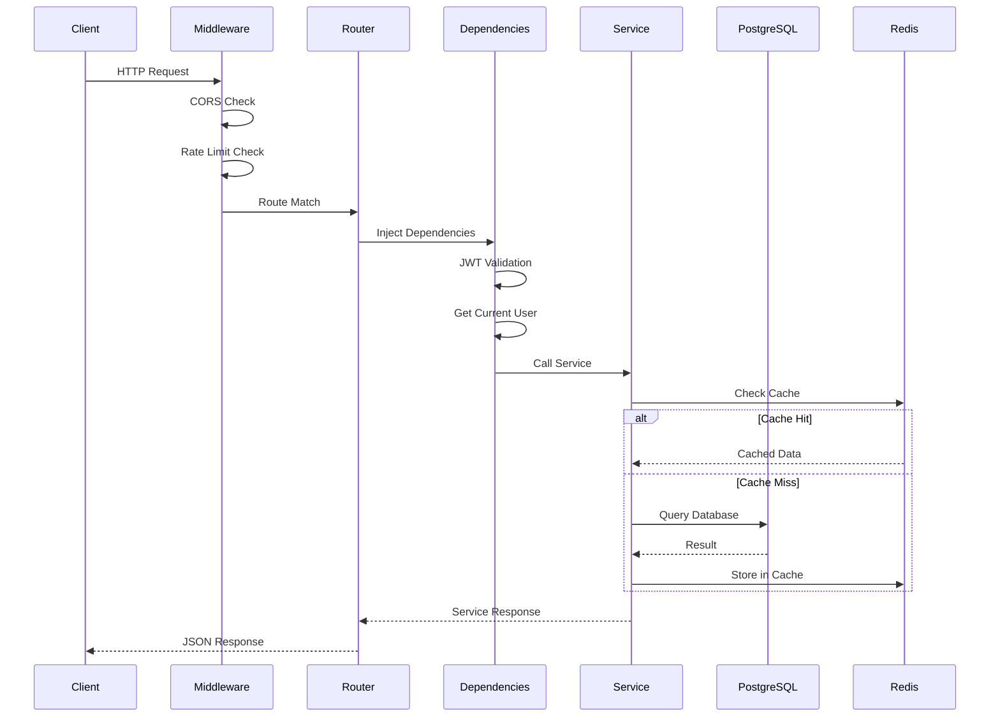
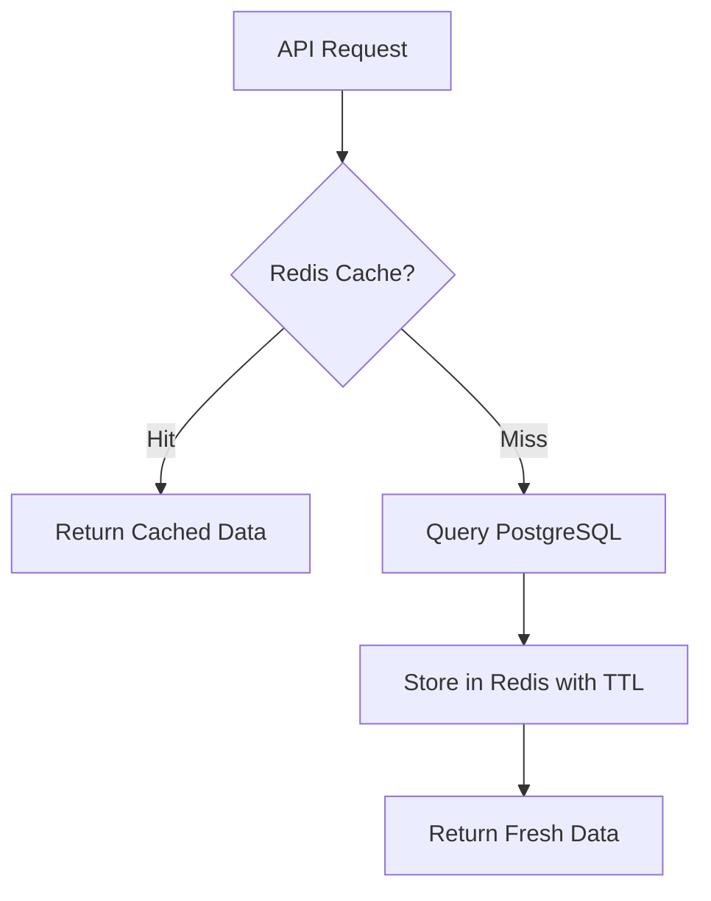
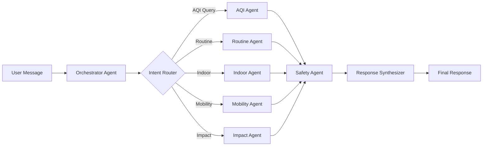
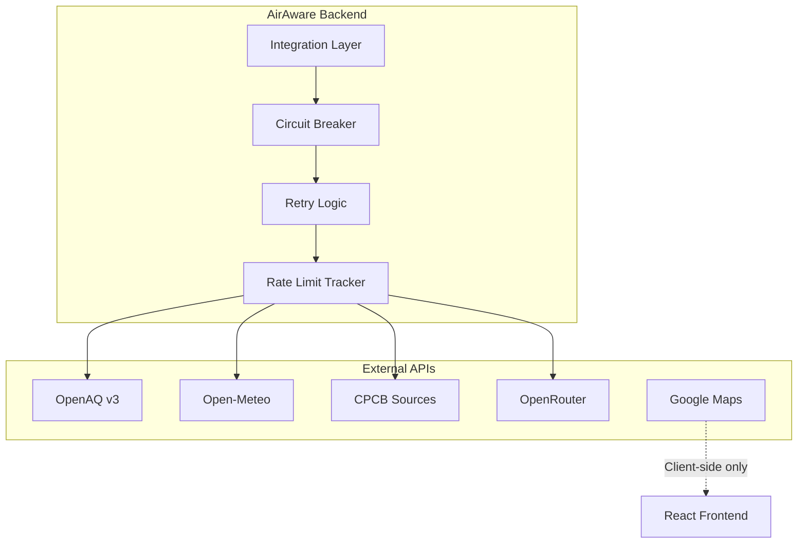
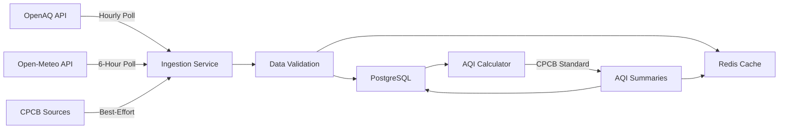
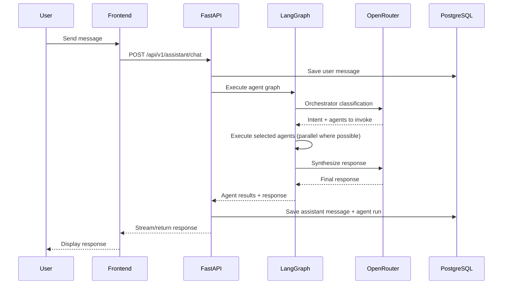
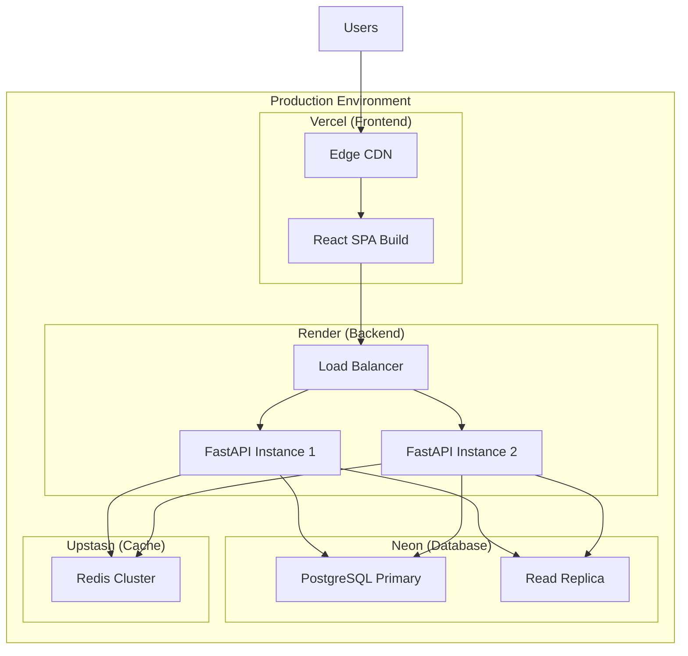

# AirAware AI — System Architecture

## 1. Architecture Overview

AirAware AI follows a modular, layered architecture with clear separation between the presentation layer (React SPA), the API layer (FastAPI), the data layer (PostgreSQL + Redis), and the AI layer (LangGraph multi-agent system). External integrations are abstracted behind service interfaces to allow provider swapping.



---

## 2. Frontend Architecture

### 2.1 Technology Stack

| Technology | Purpose | Version |
|-----------|---------|---------|
| React | UI framework | 18.x |
| TypeScript | Type safety | 5.x |
| Vite | Build tool & dev server | 5.x |
| Tailwind CSS | Utility-first styling | 3.x |
| shadcn/ui | Component library | Latest |
| Framer Motion | Animations | 11.x |
| Recharts | Data visualization | 2.x |
| @vis.gl/react-google-maps | Map integration | Latest |
| TanStack Query | Server state management | 5.x |
| Zustand | Client state management | 4.x |
| React Router | Routing | 6.x |
| Axios | HTTP client | 1.x |

### 2.2 Project Structure

```
frontend/
├── public/
│   └── assets/
├── src/
│   ├── api/                 # API client and endpoint definitions
│   │   ├── client.ts        # Axios instance with interceptors
│   │   ├── auth.ts          # Auth endpoints
│   │   ├── air-quality.ts   # AQI endpoints
│   │   ├── assistant.ts     # Chat endpoints
│   │   └── ...
│   ├── components/
│   │   ├── ui/              # shadcn/ui base components
│   │   ├── layout/          # App shell, sidebar, header
│   │   ├── dashboard/       # AQI dashboard widgets
│   │   ├── chat/            # Chat interface components
│   │   ├── map/             # Map and station components
│   │   └── common/          # Shared components
│   ├── hooks/               # Custom React hooks
│   ├── pages/               # Route-level page components
│   ├── stores/              # Zustand state stores
│   ├── types/               # TypeScript type definitions
│   ├── utils/               # Utility functions
│   ├── constants/           # App constants (AQI thresholds, etc.)
│   ├── App.tsx
│   └── main.tsx
├── index.html
├── tailwind.config.ts
├── tsconfig.json
├── vite.config.ts
└── package.json
```

### 2.3 State Management Strategy



- **TanStack Query** handles all server-derived state: AQI data, user profiles, chat history, routines. Provides automatic caching, background refetching, optimistic updates, and stale-while-revalidate patterns.
- **Zustand** handles UI-local state: authentication tokens, selected location, sidebar visibility, active chat session, theme preferences. Minimal surface area, no boilerplate.

### 2.4 Routing Architecture

| Route | Page | Auth Required |
|-------|------|---------------|
| `/` | Landing / Marketing | No |
| `/login` | Login | No |
| `/register` | Registration | No |
| `/dashboard` | AQI Dashboard | Yes |
| `/assistant` | Chat Interface | Yes |
| `/routines` | Routine Planner | Yes |
| `/indoor` | Indoor Air Guide | Yes |
| `/mobility` | Commute Intelligence | Yes |
| `/impact` | Impact Dashboard | Yes |
| `/community` | Community Reports | Yes |
| `/settings` | User Settings | Yes |
| `/settings/profile` | Profile Management | Yes |
| `/settings/notifications` | Notification Prefs | Yes |
| `/settings/household` | Household Management | Yes |

---

## 3. Backend Architecture

### 3.1 Technology Stack

| Technology | Purpose | Version |
|-----------|---------|---------|
| Python | Runtime | 3.11+ |
| FastAPI | Web framework | 0.110+ |
| Pydantic v2 | Data validation | 2.x |
| SQLAlchemy 2 | ORM | 2.x |
| Alembic | Database migrations | 1.x |
| asyncpg | Async PostgreSQL driver | 0.29+ |
| redis-py | Redis client | 5.x |
| httpx | Async HTTP client | 0.27+ |
| LangGraph | AI agent orchestration | 0.2+ |
| python-jose | JWT handling | 3.x |
| passlib | Password hashing | 1.7+ |
| uvicorn | ASGI server | 0.27+ |

### 3.2 Project Structure

```
backend/
├── app/
│   ├── api/
│   │   ├── v1/
│   │   │   ├── endpoints/
│   │   │   │   ├── auth.py
│   │   │   │   ├── users.py
│   │   │   │   ├── locations.py
│   │   │   │   ├── air_quality.py
│   │   │   │   ├── routines.py
│   │   │   │   ├── assistant.py
│   │   │   │   ├── indoor.py
│   │   │   │   ├── mobility.py
│   │   │   │   ├── impact.py
│   │   │   │   ├── community.py
│   │   │   │   ├── notifications.py
│   │   │   │   └── system.py
│   │   │   └── router.py
│   │   └── deps.py              # Dependency injection
│   ├── core/
│   │   ├── config.py            # Settings (pydantic-settings)
│   │   ├── security.py          # JWT + password utilities
│   │   ├── database.py          # SQLAlchemy engine & session
│   │   ├── redis.py             # Redis connection
│   │   └── exceptions.py        # Custom exception handlers
│   ├── models/                  # SQLAlchemy ORM models
│   │   ├── user.py
│   │   ├── location.py
│   │   ├── air_quality.py
│   │   ├── routine.py
│   │   ├── chat.py
│   │   ├── mobility.py
│   │   ├── impact.py
│   │   ├── community.py
│   │   └── notification.py
│   ├── schemas/                 # Pydantic request/response schemas
│   ├── services/                # Business logic layer
│   │   ├── auth_service.py
│   │   ├── air_quality_service.py
│   │   ├── routine_service.py
│   │   └── ...
│   ├── agents/                  # LangGraph AI agents
│   │   ├── orchestrator.py
│   │   ├── aqi_agent.py
│   │   ├── routine_agent.py
│   │   ├── indoor_agent.py
│   │   ├── mobility_agent.py
│   │   ├── impact_agent.py
│   │   ├── safety_agent.py
│   │   ├── synthesizer.py
│   │   ├── graph.py             # LangGraph graph definition
│   │   └── state.py             # Shared state schema
│   ├── integrations/            # External API clients
│   │   ├── openaq.py
│   │   ├── open_meteo.py
│   │   ├── cpcb.py
│   │   └── openrouter.py
│   └── main.py                  # FastAPI app factory
├── migrations/                  # Alembic migrations
│   ├── versions/
│   ├── env.py
│   └── alembic.ini
├── tests/
├── requirements.txt
└── Dockerfile
```

### 3.3 Request Processing Pipeline



### 3.4 Middleware Stack

| Order | Middleware | Purpose |
|-------|-----------|---------|
| 1 | CORS | Cross-origin request handling |
| 2 | Request ID | Inject `X-Request-ID` for tracing |
| 3 | Logging | Structured request/response logging |
| 4 | Rate Limiting | Per-IP and per-user rate limits |
| 5 | Error Handler | Global exception-to-HTTP mapping |

---

## 4. Database Architecture

### 4.1 PostgreSQL (via Neon)

- **Engine:** PostgreSQL 16 on Neon serverless
- **ORM:** SQLAlchemy 2 with async session support
- **Migrations:** Alembic with auto-generation from models
- **Connection Pooling:** asyncpg with SQLAlchemy's async pool (pool_size=10, max_overflow=20)
- **Naming Convention:** snake_case for tables and columns, `ix_`, `uq_`, `fk_`, `pk_`, `ck_` prefixes for constraints

### 4.2 Connection Management

```python
# Async engine configuration
engine = create_async_engine(
    settings.DATABASE_URL,
    pool_size=10,
    max_overflow=20,
    pool_pre_ping=True,
    pool_recycle=300,
)

async_session = async_sessionmaker(
    engine, class_=AsyncSession, expire_on_commit=False
)
```

### 4.3 Key Design Decisions

- **UUID primary keys** for all tables — avoids sequential ID enumeration attacks
- **UTC timestamps** with `timezone=True` on all datetime columns
- **Soft deletes** via `deleted_at` column where data retention is needed
- **Composite indexes** on (location_id, pollutant, timestamp) for air quality time-series queries
- **JSONB columns** for flexible metadata and agent execution results

---

## 5. Cache Architecture (Redis)

### 5.1 Redis (via Upstash)

Upstash provides serverless Redis with REST API fallback and per-request pricing.

### 5.2 Caching Strategy

| Data Type | Cache Key Pattern | TTL | Invalidation |
|-----------|------------------|-----|--------------|
| Current AQI | `aqi:current:{location_id}` | 5 min | On new measurement |
| AQI Forecast | `aqi:forecast:{location_id}` | 30 min | Scheduled refresh |
| Station List | `stations:nearby:{lat}:{lng}:{radius}` | 1 hour | Manual |
| User Profile | `user:profile:{user_id}` | 15 min | On profile update |
| Rate Limit | `ratelimit:{ip}:{endpoint}` | 1 min | Auto-expire |
| Chat Context | `chat:context:{session_id}` | 30 min | On new message |

### 5.3 Cache-Aside Pattern



---

## 6. AI Layer Architecture

The AI system uses LangGraph to orchestrate a multi-agent pipeline. See [AGENT_ARCHITECTURE.md](./AGENT_ARCHITECTURE.md) for complete details.

### 6.1 High-Level AI Flow



### 6.2 LLM Provider Strategy

- **Provider:** OpenRouter — provides a unified API across multiple LLM providers
- **Primary Model:** GPT-4o for complex reasoning (orchestration, synthesis)
- **Secondary Model:** GPT-4o-mini / Claude 3.5 Haiku for simple tasks (classification, extraction)
- **Fallback:** Automatic model fallback on provider outage
- **Token Budget:** Per-request token limits with early termination
- **Caching:** Response caching for identical queries within TTL window

---

## 7. External Integration Architecture



### 7.1 Resilience Patterns

| Pattern | Implementation | Config |
|---------|---------------|--------|
| Circuit Breaker | Per-provider circuit with failure threshold | 5 failures → 60s open |
| Retry | Exponential backoff with jitter | 3 retries, 1s base, 2x factor |
| Timeout | Per-request timeout | 10s data APIs, 30s LLM |
| Rate Limit | Token bucket per provider | Per provider limits |
| Fallback | Cached/stale data on provider failure | Serve stale + warning badge |

See [INTEGRATIONS.md](./INTEGRATIONS.md) for per-provider integration details.

---

## 8. Data Flow Architecture

### 8.1 AQI Data Pipeline



### 8.2 Chat Message Flow



---

## 9. Deployment Architecture



See [DEPLOYMENT.md](./DEPLOYMENT.md) for complete deployment configuration, environment variables, and production checklist.

---

## 10. Cross-Cutting Concerns

### 10.1 Logging

- **Format:** Structured JSON logs with `structlog`
- **Correlation:** `X-Request-ID` header propagated through all layers
- **Levels:** DEBUG (dev), INFO (prod), WARNING/ERROR (alerts)
- **Sensitive Data:** Never log passwords, tokens, API keys, or PII

### 10.2 Error Handling

```json
{
  "error": {
    "code": "RESOURCE_NOT_FOUND",
    "message": "Location with ID abc123 not found",
    "details": null,
    "request_id": "req_7f3a8b2c"
  }
}
```

### 10.3 Health Checks

| Endpoint | Purpose | Checks |
|----------|---------|--------|
| `GET /health` | Liveness | App is running |
| `GET /ready` | Readiness | DB + Redis connected |
| `GET /api/v1/system/status` | Full status | All services + integrations |

### 10.4 Monitoring

- **Metrics:** Request rate, latency percentiles, error rate, cache hit ratio
- **Alerts:** P95 latency > 3s, error rate > 5%, external API failures
- **Dashboards:** System health, AQI data freshness, AI agent performance

---

*Last updated: Phase 0 — Foundation*
