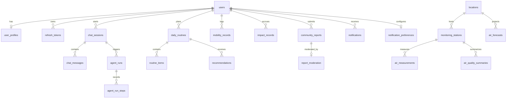

# Database Schema Documentation

## Database Engine & Standards
- **Engine**: PostgreSQL 16+
- **ORM**: SQLAlchemy 2.0 (Async Engine with asyncpg)
- **Primary Keys**: UUIDv4 (`gen_random_uuid()` / `uuid.uuid4`)
- **Timestamps**: All timestamps stored with timezone (`TIMESTAMP WITH TIME ZONE`), recorded in UTC.
- **Auditing**: Standard `created_at` and `updated_at` columns across all persistent entities.

---

## Entity Relationship Overview

---

## Detailed Table Definitions

### 1. Authentication & User Management

#### `users`
| Column | Type | Constraints | Description |
|---|---|---|---|
| `id` | UUID | PK, default uuid4 | Unique user identifier |
| `email` | VARCHAR(255) | UNIQUE, NOT NULL, INDEX | Primary email address |
| `hashed_password` | VARCHAR(255) | NOT NULL | Bcrypt hashed password |
| `display_name` | VARCHAR(100) | NOT NULL | User's full or preferred name |
| `is_active` | BOOLEAN | NOT NULL, DEFAULT true | Account status flag |
| `is_verified` | BOOLEAN | NOT NULL, DEFAULT false | Email verification flag |
| `role` | VARCHAR(20) | NOT NULL, DEFAULT 'user' | Access tier: 'user', 'moderator', 'admin' |
| `created_at` | TIMESTAMPTZ | NOT NULL, DEFAULT now() | Account creation time |
| `updated_at` | TIMESTAMPTZ | NOT NULL, DEFAULT now() | Last update timestamp |

#### `user_profiles`
| Column | Type | Constraints | Description |
|---|---|---|---|
| `id` | UUID | PK, default uuid4 | Profile record ID |
| `user_id` | UUID | FK(users.id, CASCADE), UNIQUE, NOT NULL | Associated user |
| `city` | VARCHAR(100) | NULL | Primary city of residence |
| `preferred_location_lat` | FLOAT | NULL | Preferred latitude coordinate |
| `preferred_location_lng` | FLOAT | NULL | Preferred longitude coordinate |
| `preferred_location_name` | VARCHAR(255) | NULL | Address or neighborhood name |
| `occupation` | VARCHAR(100) | NULL | Daily activity or occupation |
| `commute_type` | VARCHAR(50) | NULL | Primary commute mode (metro, car, cycle, walk) |
| `commute_duration_mins` | INTEGER | NULL | Daily round-trip commute duration |
| `outdoor_activity_type` | VARCHAR(50) | NULL | Jogging, cycling, walking, sports |
| `notification_preferences` | JSONB | NOT NULL, DEFAULT '{}' | In-app, push, and email alert thresholds |
| `household_context` | JSONB | NOT NULL, DEFAULT '{}' | Air purifier ownership, pets, children, elderly |
| `created_at` | TIMESTAMPTZ | NOT NULL, DEFAULT now() | Record creation |
| `updated_at` | TIMESTAMPTZ | NOT NULL, DEFAULT now() | Record update |

#### `refresh_tokens`
| Column | Type | Constraints | Description |
|---|---|---|---|
| `id` | UUID | PK, default uuid4 | Token entry ID |
| `user_id` | UUID | FK(users.id, CASCADE), NOT NULL, INDEX | User token owner |
| `token_hash` | VARCHAR(255) | UNIQUE, NOT NULL, INDEX | SHA256 hash of refresh token |
| `expires_at` | TIMESTAMPTZ | NOT NULL, INDEX | Token validity cutoff |
| `revoked` | BOOLEAN | NOT NULL, DEFAULT false | Revocation flag |
| `created_at` | TIMESTAMPTZ | NOT NULL, DEFAULT now() | Issue time |

---

### 2. Environmental Stations & Geospatial Data

#### `locations`
| Column | Type | Constraints | Description |
|---|---|---|---|
| `id` | UUID | PK, default uuid4 | Location entity ID |
| `name` | VARCHAR(255) | NOT NULL, INDEX | Neighborhood / Area / City |
| `city` | VARCHAR(100) | NOT NULL, INDEX | City name (e.g., Delhi, Mumbai, Kolkata) |
| `state` | VARCHAR(100) | NOT NULL | State name |
| `country` | VARCHAR(10) | NOT NULL, DEFAULT 'IN' | ISO country code |
| `latitude` | FLOAT | NOT NULL, INDEX | WGS84 Latitude |
| `longitude` | FLOAT | NOT NULL, INDEX | WGS84 Longitude |
| `created_at` | TIMESTAMPTZ | NOT NULL, DEFAULT now() | Created at |
| `updated_at` | TIMESTAMPTZ | NOT NULL, DEFAULT now() | Updated at |

#### `monitoring_stations`
| Column | Type | Constraints | Description |
|---|---|---|---|
| `id` | UUID | PK, default uuid4 | Station ID |
| `location_id` | UUID | FK(locations.id, SET NULL), NULL | Linked location region |
| `external_id` | VARCHAR(100) | UNIQUE, NOT NULL, INDEX | CPCB / OpenAQ source station identifier |
| `name` | VARCHAR(255) | NOT NULL | Station name (e.g., "Anand Vihar, Delhi - DPCC") |
| `agency` | VARCHAR(100) | NOT NULL | CPCB, DPCC, WBPCB, US Embassy |
| `latitude` | FLOAT | NOT NULL | Latitude |
| `longitude` | FLOAT | NOT NULL | Longitude |
| `is_active` | BOOLEAN | NOT NULL, DEFAULT true | Operational state |
| `last_data_at` | TIMESTAMPTZ | NULL, INDEX | Freshness timestamp of latest reading |
| `created_at` | TIMESTAMPTZ | NOT NULL, DEFAULT now() | Ingestion start |
| `updated_at` | TIMESTAMPTZ | NOT NULL, DEFAULT now() | Last record update |

#### `air_measurements`
| Column | Type | Constraints | Description |
|---|---|---|---|
| `id` | UUID | PK, default uuid4 | Reading ID |
| `station_id` | UUID | FK(monitoring_stations.id, CASCADE), NOT NULL, INDEX | Station source |
| `pollutant` | VARCHAR(20) | NOT NULL, INDEX | pm25, pm10, no2, so2, co, o3, nh3, pb |
| `value` | FLOAT | NOT NULL | Numerical concentration |
| `unit` | VARCHAR(20) | NOT NULL | µg/m³, mg/m³, ppm |
| `sub_index` | FLOAT | NULL | CPCB sub-index calculation result |
| `averaging_period_hours` | INTEGER | NOT NULL, DEFAULT 24 | Standard averaging duration (24h or 8h for CO/O3) |
| `data_quality` | VARCHAR(20) | NOT NULL, DEFAULT 'verified' | 'verified', 'raw', 'estimated' |
| `measured_at` | TIMESTAMPTZ | NOT NULL, INDEX | Primary observation time |
| `recorded_at` | TIMESTAMPTZ | NOT NULL, DEFAULT now() | System ingestion time |

*Compound Indexes:* `idx_station_pollutant_time (station_id, pollutant, measured_at DESC)`

#### `air_quality_summaries`
| Column | Type | Constraints | Description |
|---|---|---|---|
| `id` | UUID | PK, default uuid4 | Summary ID |
| `station_id` | UUID | FK(monitoring_stations.id, CASCADE), NOT NULL, INDEX | Station source |
| `aqi` | INTEGER | NOT NULL, INDEX | Official / Calculated CPCB AQI (0-500) |
| `category` | VARCHAR(20) | NOT NULL | Good, Satisfactory, Moderate, Poor, Very Poor, Severe |
| `prominent_pollutant` | VARCHAR(20) | NOT NULL | Driver pollutant of the max sub-index |
| `standard` | VARCHAR(20) | NOT NULL, DEFAULT 'IN_CPCB' | Applied AQI standard |
| `calculation_method` | VARCHAR(30) | NOT NULL | 'cpcb_official', 'cpcb_subindex_max' |
| `measured_at` | TIMESTAMPTZ | NOT NULL, INDEX | Timestamp of observation |
| `created_at` | TIMESTAMPTZ | NOT NULL, DEFAULT now() | Ingest time |

#### `air_forecasts`
| Column | Type | Constraints | Description |
|---|---|---|---|
| `id` | UUID | PK, default uuid4 | Forecast ID |
| `location_id` | UUID | FK(locations.id, CASCADE), NOT NULL, INDEX | Geographic region |
| `source` | VARCHAR(50) | NOT NULL, DEFAULT 'open_meteo' | Forecasting provider |
| `forecast_time` | TIMESTAMPTZ | NOT NULL, INDEX | Target time point of prediction |
| `predicted_aqi` | INTEGER | NULL | Predicted Indian AQI |
| `predicted_category`| VARCHAR(20) | NULL | CPCB category |
| `predicted_pm25` | FLOAT | NULL | PM2.5 in µg/m³ |
| `predicted_pm10` | FLOAT | NULL | PM10 in µg/m³ |
| `temperature_c` | FLOAT | NULL | Ambient temperature |
| `relative_humidity` | FLOAT | NULL | Humidity percentage |
| `wind_speed_kmh` | FLOAT | NULL | Wind speed |
| `created_at` | TIMESTAMPTZ | NOT NULL, DEFAULT now() | Generation time |

---

### 3. Personal Planning & Recommendations

#### `daily_routines`
| Column | Type | Constraints | Description |
|---|---|---|---|
| `id` | UUID | PK, default uuid4 | Routine ID |
| `user_id` | UUID | FK(users.id, CASCADE), NOT NULL, INDEX | Target user |
| `target_date` | DATE | NOT NULL, INDEX | Date routine applies to |
| `headline` | VARCHAR(255) | NOT NULL | Summary executive title |
| `summary` | TEXT | NOT NULL | AI-grounded environmental advisory |
| `aqi_context` | JSONB | NOT NULL | AQI value, category, prominent pollutant context |
| `status` | VARCHAR(20) | NOT NULL, DEFAULT 'active' | active, archived, completed |
| `created_at` | TIMESTAMPTZ | NOT NULL, DEFAULT now() | Creation time |
| `updated_at` | TIMESTAMPTZ | NOT NULL, DEFAULT now() | Last update |

#### `routine_items`
| Column | Type | Constraints | Description |
|---|---|---|---|
| `id` | UUID | PK, default uuid4 | Item ID |
| `routine_id` | UUID | FK(daily_routines.id, CASCADE), NOT NULL, INDEX | Parent routine |
| `time_period` | VARCHAR(20) | NOT NULL | morning, travel, work, afternoon, evening, night |
| `title` | VARCHAR(150) | NOT NULL | Activity action name |
| `recommendation` | TEXT | NOT NULL | Full action recommendation |
| `environmental_reason` | TEXT | NOT NULL | Empirical justification (e.g. "PM2.5 peaks at 8 AM") |
| `is_completed` | BOOLEAN | NOT NULL, DEFAULT false | User completion checkbox |
| `completed_at` | TIMESTAMPTZ | NULL | Timestamp of completion |
| `order_index` | INTEGER | NOT NULL, DEFAULT 0 | Ordering sequence |

---

### 4. Conversational AI & Agent Orchestration

#### `chat_sessions`
| Column | Type | Constraints | Description |
|---|---|---|---|
| `id` | UUID | PK, default uuid4 | Conversation ID |
| `user_id` | UUID | FK(users.id, SET NULL), NULL, INDEX | User (null for guest queries) |
| `title` | VARCHAR(200) | NOT NULL, DEFAULT 'New Consultation' | Thread title |
| `created_at` | TIMESTAMPTZ | NOT NULL, DEFAULT now() | Thread start |
| `updated_at` | TIMESTAMPTZ | NOT NULL, DEFAULT now() | Thread update |

#### `chat_messages`
| Column | Type | Constraints | Description |
|---|---|---|---|
| `id` | UUID | PK, default uuid4 | Message ID |
| `session_id` | UUID | FK(chat_sessions.id, CASCADE), NOT NULL, INDEX | Associated thread |
| `sender` | VARCHAR(20) | NOT NULL | 'user', 'assistant', 'system' |
| `content` | TEXT | NOT NULL | Full textual response or prompt |
| `metadata` | JSONB | NOT NULL, DEFAULT '{}' | Supporting data, citations, agents used, timestamps |
| `created_at` | TIMESTAMPTZ | NOT NULL, DEFAULT now() | Message creation |

#### `agent_runs`
| Column | Type | Constraints | Description |
|---|---|---|---|
| `id` | UUID | PK, default uuid4 | Run ID |
| `session_id` | UUID | FK(chat_sessions.id, SET NULL), NULL | Conversation link |
| `user_id` | UUID | FK(users.id, SET NULL), NULL | User initiating run |
| `intent` | VARCHAR(50) | NOT NULL | Classified intent |
| `status` | VARCHAR(20) | NOT NULL | pending, running, completed, failed |
| `execution_time_ms` | INTEGER | NULL | Total execution duration |
| `token_usage` | JSONB | NOT NULL, DEFAULT '{}' | Prompt and completion tokens |
| `error_details` | TEXT | NULL | Traceback on failure |
| `created_at` | TIMESTAMPTZ | NOT NULL, DEFAULT now() | Run timestamp |

---

### 5. Sustainable Mobility & Personal Impact

#### `emission_factors`
| Column | Type | Constraints | Description |
|---|---|---|---|
| `id` | UUID | PK, default uuid4 | Factor ID |
| `mode` | VARCHAR(50) | UNIQUE, NOT NULL | private_car_petrol, private_car_diesel, ev, motorcycle, bus, metro, bicycle, walking |
| `co2e_per_km_grams`| FLOAT | NOT NULL | Grams of CO2e per passenger-kilometer |
| `source` | VARCHAR(100) | NOT NULL | IPCC, ARAI, CEA India official dataset |
| `effective_year` | INTEGER | NOT NULL, DEFAULT 2024 | Validity year |

#### `mobility_records`
| Column | Type | Constraints | Description |
|---|---|---|---|
| `id` | UUID | PK, default uuid4 | Trip ID |
| `user_id` | UUID | FK(users.id, CASCADE), NOT NULL, INDEX | User record |
| `origin` | VARCHAR(255) | NOT NULL | Starting place |
| `destination` | VARCHAR(255) | NOT NULL | Ending place |
| `distance_km` | FLOAT | NOT NULL | Travel distance |
| `mode_chosen` | VARCHAR(50) | NOT NULL | Selected mode |
| `mode_baseline` | VARCHAR(50) | NOT NULL, DEFAULT 'private_car_petrol' | Counterfactual baseline mode |
| `emissions_actual_kg` | FLOAT | NOT NULL | Produced emissions in kg CO2e |
| `emissions_saved_kg` | FLOAT | NOT NULL | Emissions avoided in kg CO2e |
| `trip_date` | DATE | NOT NULL, INDEX | Date of trip |
| `created_at` | TIMESTAMPTZ | NOT NULL, DEFAULT now() | Logging time |

#### `impact_records`
| Column | Type | Constraints | Description |
|---|---|---|---|
| `id` | UUID | PK, default uuid4 | Record ID |
| `user_id` | UUID | FK(users.id, CASCADE), NOT NULL, INDEX | User link |
| `category` | VARCHAR(50) | NOT NULL | 'mobility', 'indoor_air', 'community' |
| `action_name` | VARCHAR(100) | NOT NULL | e.g. "Public Transit Commute", "Filter Cleaned" |
| `co2e_saved_kg` | FLOAT | NOT NULL, DEFAULT 0.0 | Calculated CO2e reduction |
| `exposure_points` | INTEGER | NOT NULL, DEFAULT 10 | Gamification / Health awareness credits |
| `logged_at` | TIMESTAMPTZ | NOT NULL, DEFAULT now(), INDEX | Action time |

---

### 6. Community Environmental Reports & Moderation

#### `community_reports`
| Column | Type | Constraints | Description |
|---|---|---|---|
| `id` | UUID | PK, default uuid4 | Report ID |
| `user_id` | UUID | FK(users.id, SET NULL), NULL, INDEX | Submitter |
| `category` | VARCHAR(50) | NOT NULL, INDEX | 'smoke', 'dust', 'waste_burning', 'traffic', 'industrial', 'other' |
| `description` | TEXT | NOT NULL | Detailed user report observation |
| `latitude` | FLOAT | NOT NULL, INDEX | Approximate observation latitude |
| `longitude` | FLOAT | NOT NULL, INDEX | Approximate observation longitude |
| `approx_location_name`| VARCHAR(255) | NOT NULL | Anonymized neighborhood descriptor |
| `image_url` | VARCHAR(500) | NULL | Optional verified image upload |
| `status` | VARCHAR(20) | NOT NULL, DEFAULT 'pending', INDEX | pending, approved, rejected, flagged |
| `observed_at` | TIMESTAMPTZ | NOT NULL | User reported time of event |
| `created_at` | TIMESTAMPTZ | NOT NULL, DEFAULT now() | Submission time |

#### `report_moderation`
| Column | Type | Constraints | Description |
|---|---|---|---|
| `id` | UUID | PK, default uuid4 | Moderation ID |
| `report_id` | UUID | FK(community_reports.id, CASCADE), UNIQUE, NOT NULL | Associated report |
| `moderator_id` | UUID | FK(users.id, SET NULL), NULL | Reviewing staff |
| `decision` | VARCHAR(20) | NOT NULL | 'approved', 'rejected', 'flagged' |
| `notes` | TEXT | NULL | Moderator rationale |
| `moderated_at` | TIMESTAMPTZ | NOT NULL, DEFAULT now() | Decision timestamp |

---

### 7. Notifications & Alerts

#### `notifications`
| Column | Type | Constraints | Description |
|---|---|---|---|
| `id` | UUID | PK, default uuid4 | Notification ID |
| `user_id` | UUID | FK(users.id, CASCADE), NOT NULL, INDEX | Target user |
| `title` | VARCHAR(150) | NOT NULL | Alert title |
| `message` | TEXT | NOT NULL | Alert text |
| `type` | VARCHAR(30) | NOT NULL | 'aqi_spike', 'forecast_change', 'routine_alert', 'maintenance' |
| `severity` | VARCHAR(20) | NOT NULL, DEFAULT 'info' | 'info', 'warning', 'critical' |
| `is_read` | BOOLEAN | NOT NULL, DEFAULT false, INDEX | Read status |
| `created_at` | TIMESTAMPTZ | NOT NULL, DEFAULT now(), INDEX | Push time |

#### `notification_preferences`
| Column | Type | Constraints | Description |
|---|---|---|---|
| `id` | UUID | PK, default uuid4 | Preference ID |
| `user_id` | UUID | FK(users.id, CASCADE), UNIQUE, NOT NULL | User configuration |
| `aqi_threshold` | INTEGER | NOT NULL, DEFAULT 200 | Alert trigger threshold (CPCB AQI) |
| `daily_summary_time`| VARCHAR(5) | NOT NULL, DEFAULT '07:30' | 24-hr format time for morning brief |
| `notify_routine` | BOOLEAN | NOT NULL, DEFAULT true | Enable routine reminders |
| `notify_indoor_maintenance`| BOOLEAN| NOT NULL, DEFAULT true | Enable filter check reminders |
| `created_at` | TIMESTAMPTZ | NOT NULL, DEFAULT now() | Initial setting |
| `updated_at` | TIMESTAMPTZ | NOT NULL, DEFAULT now() | Update setting |
